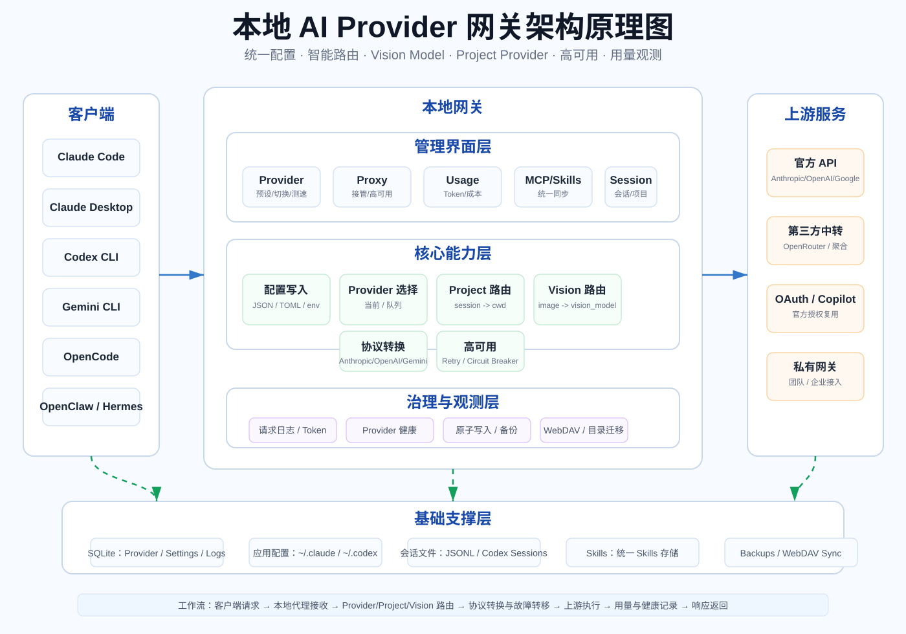
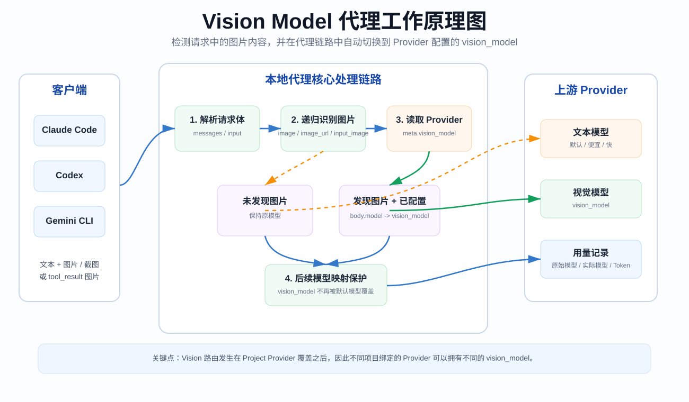
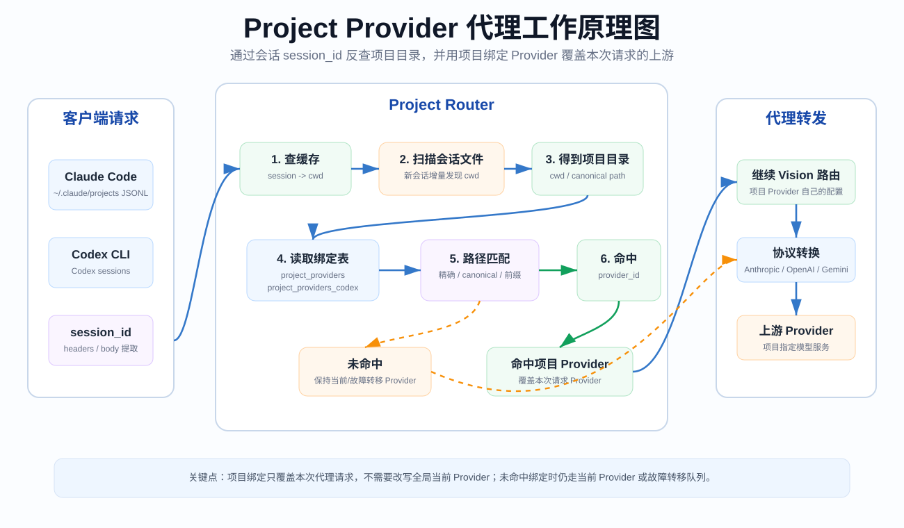
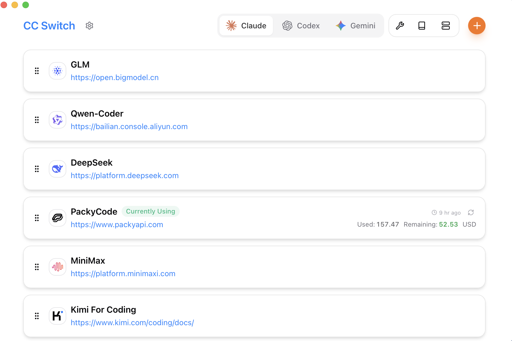
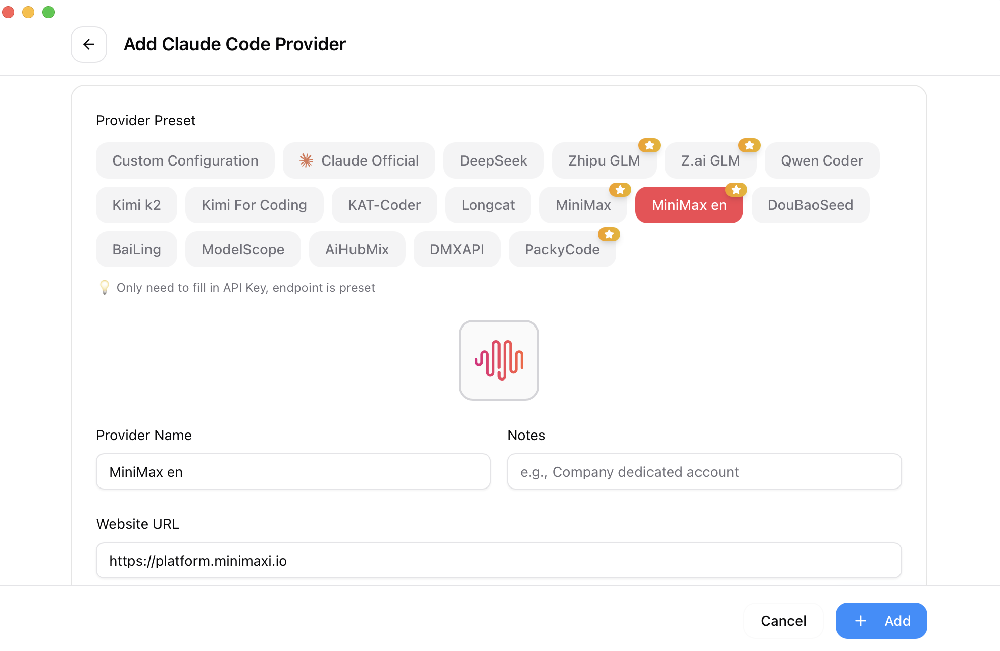
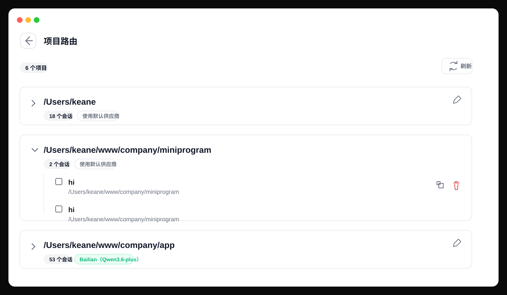
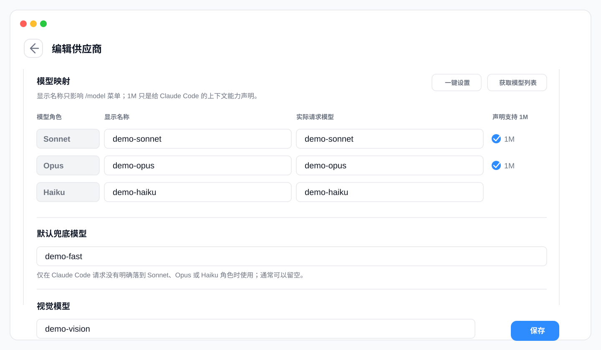
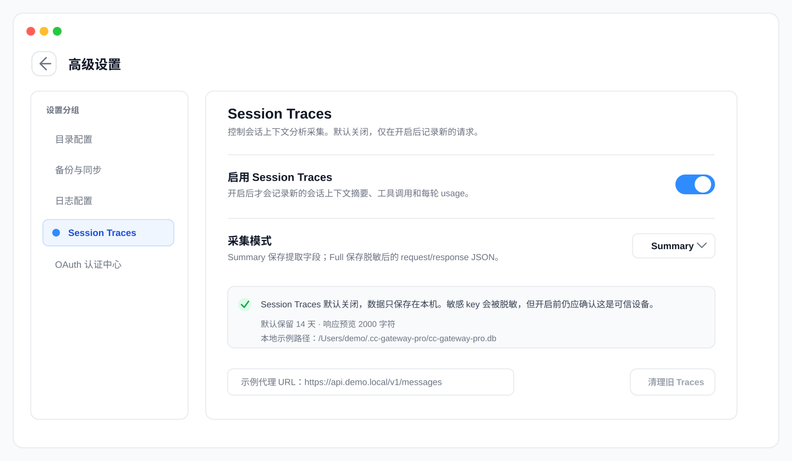
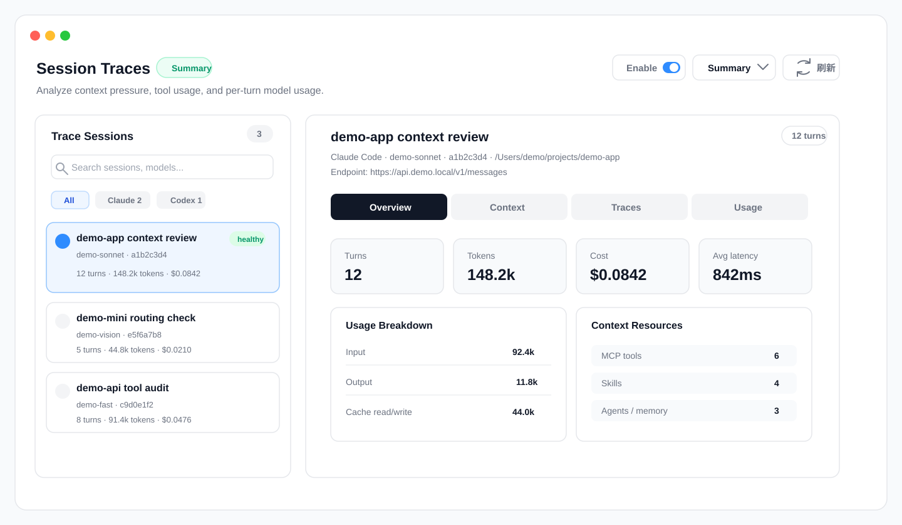

<div align="center">

# CC-Gateway-Pro

### Gateway locale di provider AI per Claude Code, Claude Desktop, Codex, Gemini CLI, OpenCode, OpenClaw e Hermes

[](https://github.com/KeaneFeng/cc-gateway-pro/releases)
[](https://github.com/KeaneFeng/cc-gateway-pro/releases)
[](https://tauri.app/)

[English](README.md) | [中文](README_ZH.md) | [日本語](README_JA.md) | [Svenska](README_SV.md) | [Español](README_ES.md) | Italiano | [Changelog](CHANGELOG.md)

</div>

## Che cos'è CC-Gateway-Pro?

CC-Gateway-Pro è un pannello di controllo desktop e un gateway locale di provider AI per gli strumenti di coding assistito dall'IA. Gestisce i profili dei provider, scrive i file di configurazione nativi di ciascuno strumento e può instradare le richieste in tempo reale attraverso un proxy locale per la registrazione delle richieste, le tracce di sessione, il failover, la trasformazione dei modelli, l'associazione dei provider a livello di progetto e l'instradamento del Vision Model.

CC-Gateway-Pro gestisce provider locali, instradamento a livello di progetto, instradamento del Vision Model e osservabilità delle richieste per gli strumenti di coding assistito dall'IA. Prende come riferimento [cc-switch](https://github.com/farion1231/cc-switch); il codice riutilizzato e i contributi a monte sono documentati nella storia del progetto. Consulta la [storia del progetto e le attribuzioni](docs/project-history.md) e i [contributi verificati](docs/original-contributions.md).

## Applicazioni supportate

| App           | Funzionalità principali                                                                                            |
| ------------- | ------------------------------------------------------------------------------------------------------------------ |
| Claude Code   | Cambio provider, presa in carico del proxy locale, instradamento per progetto, instradamento Vision Model, MCP, prompt, skill, sessioni |
| Claude Desktop | Profili ufficiali e di terze parti, modalità diretta, modalità instradata localmente, mappatura delle route dei modelli |
| Codex         | Cambio provider, presa in carico del proxy locale, instradamento per progetto, helper OAuth/Copilot, MCP, prompt, skill, sessioni |
| Gemini CLI    | Cambio provider, presa in carico del proxy locale, MCP, prompt, skill, sessioni                                    |
| Grok Build    | Cambio provider, presa in carico del proxy locale, quota, failover, MCP, prompt, skill, sessioni                   |
| OpenCode      | Preset di provider, frammenti di configurazione comuni, MCP, prompt, skill, sessioni                               |
| OpenClaw      | Preset di provider, file di workspace, valori predefiniti degli agent, pannali strumenti e ambiente               |
| Hermes Agent  | Preset di provider, pannello memoria, gestione di MCP e skill                                                      |

## Funzionalità principali

- **Gestione dei provider**: oltre 50 preset, provider personalizzati, ordinamento tramite trascinamento, importazione/esportazione, test di velocità degli endpoint, helper per saldo e quota.
- **Gateway proxy locale**: proxy Tauri/Rust + Axum su `127.0.0.1:15721` per impostazione predefinita, con presa in carico per app per Claude, Claude Desktop, Codex e Gemini.
- **Adattamento del formato API**: Anthropic, OpenAI Chat Completions, OpenAI Responses, Gemini e percorsi di compatibilità specifici dei provider.
- **Instradamento a livello di progetto**: le sessioni di Claude e Codex possono essere mappate dai file di sessione locali alle directory dei progetti e quindi instradate ai provider associati al progetto.
- **Instradamento del Vision Model**: le richieste contenenti blocchi di immagini possono passare automaticamente al `vision_model` configurato del provider.
- **Alta disponibilità**: code di failover per app, circuit breaker, tentativi automatici, stato di salute, controlli di timeout per flussi streaming e non.
- **Log delle richieste del proxy**: consulta i log delle richieste del proxy degli ultimi 7 giorni nel terminale che preferisci, con scorrimento in tempo reale.
- **Analisi dell'utilizzo**: log delle richieste, utilizzo dei token, stima dei costi, tendenze, suddivisioni per provider/modello e prezzi personalizzati.
- **Tracce di sessione**: analisi del contesto locale su base opt-in per le nuove richieste, con cattura Summary per i campi estratti e cattura Full per il JSON delle richieste/risposte offuscato.
- **MCP, prompt e skill**: gestione unificata, sincronizzazione tra le app supportate, deep link, installazione di skill da repository/ZIP.
- **Sicurezza dei dati**: archiviazione su SQLite, scritture atomiche della configurazione, backup automatici, directory di archiviazione configurabile e sincronizzazione WebDAV.

## Diagrammi di architettura

### Gateway locale di provider AI



### Flusso del proxy Vision Model



### Flusso del proxy dei provider di progetto



Altri diagrammi su failover, registrazione dell'utilizzo, sincronizzazione di MCP/Prompt/Skill e la catena completa delle richieste sono disponibili in [Architettura e flussi](docs/architecture-and-flows-zh.md).

## Anteprima dell'interfaccia

|                 Schermata principale                 |                    Aggiungi provider                    |
| :--------------------------------------------------: | :-----------------------------------------------------: |
|  |  |

|                          Instradamento per progetto                          |                          Configurazione del Vision Model                          |
| :-------------------------------------------------------------------------: | :-------------------------------------------------------------------------------: |
|  |  |

|                        Impostazioni delle tracce di sessione                        |                        Analisi delle tracce di sessione                        |
| :---------------------------------------------------------------------------------: | :----------------------------------------------------------------------------: |
|  |  |

## Installazione

Scarica la build più recente da [GitHub Releases](https://github.com/KeaneFeng/cc-gateway-pro/releases).

Requisiti di sistema:

- macOS 12 o successivo
- Windows 10 o successivo
- Linux: WebKitGTK 4.1 / libsoup 3; le build di release usano Ubuntu 22.04. Le altre distribuzioni richiedono una verifica di compatibilità locale.

### macOS Homebrew

Molti utenti devono aggiornare i metadati di Homebrew prima che il cask possa essere trovato o aggiornato correttamente:

```bash
brew update
brew tap KeaneFeng/cc-gateway-pro
brew install --cask cc-gateway-pro
```

Aggiornamento:

```bash
brew update
brew upgrade --cask cc-gateway-pro
```

### Download manuale

- Windows: `.msi` / `.exe` — [GitHub Releases](https://github.com/KeaneFeng/cc-gateway-pro/releases/latest).
- macOS: scarica il `.dmg` da [Releases](https://github.com/KeaneFeng/cc-gateway-pro/releases).
- Linux: scarica il `.deb`, `.rpm` o `.AppImage` da [Releases](https://github.com/KeaneFeng/cc-gateway-pro/releases).
- Canali di pacchettizzazione aggiuntivi: verifica la disponibilità presso il distributore; GitHub Releases è la fonte di download autorevole.

## Compilazione dai sorgenti

Prerequisiti: Node.js 22.12+, pnpm 10.12.3 e Rust 1.95 (rust-toolchain.toml).

```bash
pnpm install --frozen-lockfile
pnpm tauri dev
pnpm tauri build
```

Il repository include anche uno script di supporto:

```bash
./build.sh --dev
./build.sh --release
./build.sh --dmg
./build.sh --sha
```

## Documentazione

- [README in cinese](README_ZH.md)
- [README in giapponese](README_JA.md)
- [README in svedese](README_SV.md)
- [README in spagnolo](README_ES.md)
- [README in inglese](README.md)
- [Manuale utente](docs/user-manual/zh/README.md)
- [Architettura e flussi](docs/architecture-and-flows-zh.md)
- [Guida al proxy](docs/proxy-guide-zh.md)
- [Note di rilascio](https://github.com/KeaneFeng/cc-gateway-pro/releases/latest)

## Posizioni dei dati

- Database principale: `~/.cc-gateway-pro/cc-gateway-pro.db`
- Impostazioni del dispositivo: `~/.cc-gateway-pro/settings.json`
- Backup: `~/.cc-gateway-pro/backups/`
- Skill: `~/.cc-gateway-pro/skills/`

La directory di archiviazione può essere spostata in Dropbox, OneDrive, iCloud, NAS o un'altra cartella sincronizzata dalla pagina delle impostazioni.

## Riconoscimenti

- Riferimento: [farion1231/cc-switch](https://github.com/farion1231/cc-switch)
- Realizzato con Tauri, Rust, React, TypeScript e Tailwind CSS

## Licenza

[Licenza MIT](LICENSE) — Copyright (c) 2025 Jason Young.

CC-Gateway-Pro è mantenuto da [KeaneFeng](https://github.com/KeaneFeng). I diritti d'autore e le note di autorizzazione a monte sono conservati; consulta la [storia del progetto](docs/project-history.md).

## Sviluppo e evidenze del progetto

- [Comandi di sviluppo, compilazione e test](CONTRIBUTING.md)
- [Segnalazioni di sicurezza](SECURITY.md) · [Modelli di issue](https://github.com/KeaneFeng/cc-gateway-pro/issues/new/choose)
- [Storia del progetto e attribuzioni](docs/project-history.md)
- [Contributi verificati e stato delle release](docs/original-contributions.md)
- [Priorità di manutenzione](docs/roadmap.md)
- [Audit datato del repository](docs/jetbrains-application-audit.md)

Le anteprime SVG dell'interfaccia sopra riportate utilizzano dati dimostrativi; sono illustrazioni, non evidenze di utilizzo in produzione.
