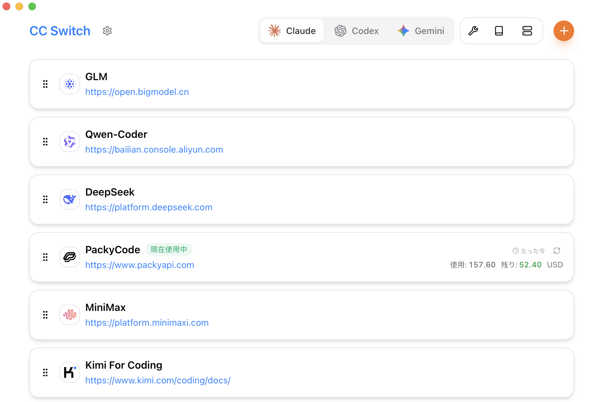
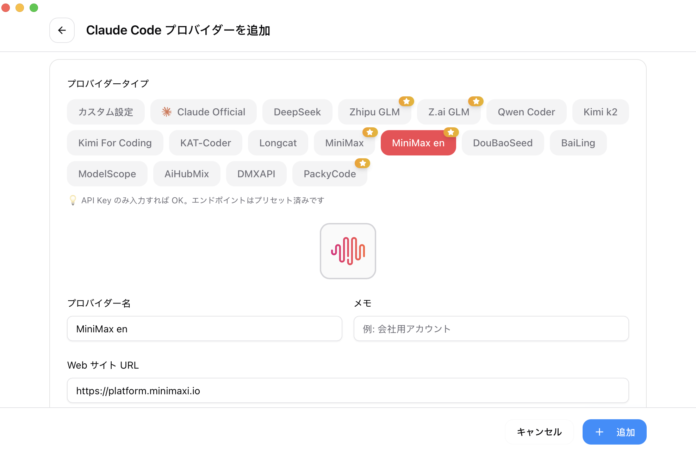

<div align="center">

# CC-Gateway-Pro

### Claude Code、Claude Desktop、Codex、Gemini CLI、OpenCode、OpenClaw、Hermes 向けローカル AI Provider Gateway

[](https://github.com/KeaneFeng/cc-gateway-pro/releases)
[](https://github.com/KeaneFeng/cc-gateway-pro/releases)
[](https://tauri.app/)

[English](README.md) | [中文](README_ZH.md) | 日本語 | [Svenska](README_SV.md) | [Español](README_ES.md) | [Changelog](CHANGELOG.md)

</div>

## CC-Gateway-Pro とは？

CC-Gateway-Pro は、AI コーディングツール向けのデスクトップ管理画面兼ローカル AI Provider Gateway です。プロバイダープロファイルを管理し、各ツールのネイティブ設定ファイルを書き込み、ローカルプロキシ経由で実リクエストをルーティングして、リクエストログ、Session Traces、フェイルオーバー、モデル変換、プロジェクト単位の Provider バインド、Vision Model ルーティングを実現します。

CC-Gateway-Pro はローカルプロバイダー管理、プロジェクト別ルーティング、Vision Model ルーティング、リクエスト分析を提供します。[cc-switch](https://github.com/farion1231/cc-switch) を参照しており、コードの再利用と上流の貢献はプロジェクト履歴に記載しています。[プロジェクト履歴](docs/project-history.md)と[検証可能な変更](docs/original-contributions.md)を参照してください。

## 対応アプリ

| アプリ         | 主な機能                                                                                                                     |
| -------------- | ---------------------------------------------------------------------------------------------------------------------------- |
| Claude Code    | Provider 切り替え、ローカルプロキシ接管、プロジェクトルーティング、Vision Model ルーティング、MCP、Prompts、Skills、Sessions |
| Claude Desktop | 公式/サードパーティプロファイル、直接接続モード、ローカルルーティングモード、モデルマッピング                                |
| Codex          | Provider 切り替え、ローカルプロキシ接管、プロジェクトルーティング、OAuth/Copilot 補助、MCP、Prompts、Skills、Sessions        |
| Gemini CLI     | Provider 切り替え、ローカルプロキシ接管、MCP、Prompts、Skills、Sessions                                                      |
| Grok Build     | Provider 切り替え、ローカルプロキシ接管、クォータ、フェイルオーバー、MCP、Prompts、Skills、Sessions                          |
| OpenCode       | Provider プリセット、共通設定スニペット、MCP、Prompts、Skills、Sessions                                                      |
| OpenClaw       | Provider プリセット、ワークスペースファイル、Agent 既定値、ツール/環境変数パネル                                             |
| Hermes Agent   | Provider プリセット、Memory パネル、MCP と Skills 管理                                                                       |

## 主な機能

- **Provider 管理**：50 以上のプリセット、カスタム Provider、ドラッグ並び替え、インポート/エクスポート、エンドポイント速度テスト、残高とクォータ補助。
- **ローカルプロキシゲートウェイ**：既定で `127.0.0.1:15721` を使用し、Tauri/Rust + Axum により Claude、Claude Desktop、Codex、Gemini のアプリ単位プロキシ接管を提供。
- **API 形式の変換**：Anthropic、OpenAI Chat Completions、OpenAI Responses、Gemini、プロバイダー固有の互換パスに対応。
- **プロジェクト単位ルーティング**：Claude/Codex のローカルセッションファイルからプロジェクトディレクトリを識別し、プロジェクトに紐づく Provider へルーティング。
- **Vision Model ルーティング**：画像ブロックを含むリクエストを、現在の Provider に設定された `vision_model` へ自動切り替え。
- **高可用性**：アプリ単位のフェイルオーバーキュー、サーキットブレーカー、リトライ、ヘルス状態、ストリーム/非ストリームのタイムアウト制御。
- **プロキシリクエストログ**：View Logs から、過去 7 日分のプロキシリクエストログを好みのターミナルでリアルタイム表示。
- **使用量分析**：リクエストログ、Token 使用量、コスト見積もり、トレンド、Provider/モデル別集計、カスタム価格。
- **Session Traces**：既定ではオフ。オンにした後の新しいリクエストだけを対象に、コンテキスト要約、ツール呼び出し、ターンごとの usage をローカル保存。Summary は抽出フィールド、Full はマスク済み request/response JSON を保存します。
- **MCP、Prompts、Skills**：対応アプリ間で統一管理と同期、Deep Link、リポジトリ/ZIP からの Skill インストール。
- **データ保護**：SQLite ストレージ、アトミック書き込み、自動バックアップ、移動可能なデータディレクトリ、WebDAV 同期。

## アーキテクチャ図

### ローカル AI Provider Gateway


### Vision Model プロキシの仕組み


### Project Provider プロキシの仕組み


フェイルオーバー、使用量ログ、MCP/Prompts/Skills 同期、完全なリクエストチェーンについては [Architecture and Flows](docs/architecture-and-flows-zh.md) を参照してください。

## 画面プレビュー

|                  メイン画面                   |                  Provider 追加                  |
| :-------------------------------------------: | :---------------------------------------------: |
|  |  |

|                              プロジェクトルーティング                              |                                Vision Model 設定                                |
| :--------------------------------------------------------------------------------: | :-----------------------------------------------------------------------------: |
|  |  |

|                                Session Traces 設定                                 |                                Session Traces 分析                                 |
| :--------------------------------------------------------------------------------: | :--------------------------------------------------------------------------------: |
|  |  |

## ダウンロードとインストール

最新ビルドは [GitHub Releases](https://github.com/KeaneFeng/cc-gateway-pro/releases) からダウンロードできます。

システム要件：

- macOS 12 以降
- Windows 10 以降
- Linux：WebKitGTK 4.1 / libsoup 3 が必要です。リリースのビルド環境は Ubuntu 22.04 です。他の環境では互換性の検証が必要です。

### macOS Homebrew

cask が見つからない、または古いバージョンが入る場合があるため、先に Homebrew のメタデータを更新してください。

```bash
brew update
brew tap KeaneFeng/cc-gateway-pro
brew install --cask cc-gateway-pro
```

アップグレード：

```bash
brew update
brew upgrade --cask cc-gateway-pro
```

### 手動ダウンロード

- Windows: `.msi` / `.exe` — [GitHub Releases](https://github.com/KeaneFeng/cc-gateway-pro/releases/latest).
- macOS：[Releases](https://github.com/KeaneFeng/cc-gateway-pro/releases) から `.dmg` をダウンロード。
- Linux：[Releases](https://github.com/KeaneFeng/cc-gateway-pro/releases) から `.deb`、`.rpm`、`.AppImage` をダウンロード。
- その他の配布経路は提供元に確認してください。正式なダウンロード元は GitHub Releases です。

## ソースからビルド

必要なもの：Node.js 22.12+、pnpm 10.12.3、Rust 1.95 (rust-toolchain.toml)。

```bash
pnpm install --frozen-lockfile
pnpm tauri dev
pnpm tauri build
```

リポジトリには補助スクリプトも含まれています。

```bash
./build.sh --dev
./build.sh --release
./build.sh --dmg
./build.sh --sha
```

## ドキュメント

- [English README](README.md)
- [中文 README](README_ZH.md)
- [Svenska README](README_SV.md)
- [Español README](README_ES.md)
- [ユーザーマニュアル](docs/user-manual/ja/README.md)
- [Architecture and flows](docs/architecture-and-flows-zh.md)
- [Proxy guide](docs/proxy-guide-zh.md)
- [Release notes](https://github.com/KeaneFeng/cc-gateway-pro/releases/latest)

## データ保存場所

- メインデータベース：`~/.cc-gateway-pro/cc-gateway-pro.db`
- デバイス設定：`~/.cc-gateway-pro/settings.json`
- バックアップ：`~/.cc-gateway-pro/backups/`
- Skills：`~/.cc-gateway-pro/skills/`

設定画面から、データディレクトリを Dropbox、OneDrive、iCloud、NAS、または他の同期フォルダーへ移動できます。

## クレジット

- 参照：[farion1231/cc-switch](https://github.com/farion1231/cc-switch)
- Tauri、Rust、React、TypeScript、Tailwind CSS で構築

## License

[MIT License](LICENSE) — Copyright (c) 2025 Jason Young.

CC-Gateway-Pro のメンテナーは [KeaneFeng](https://github.com/KeaneFeng) です。上流の著作権と許諾表示を保持しています。[履歴](docs/project-history.md)を参照してください。

## 開発とプロジェクトの根拠

- [開発・ビルド・テストのコマンド](CONTRIBUTING.md)
- [セキュリティ報告](SECURITY.md) · [Issue テンプレート](https://github.com/KeaneFeng/cc-gateway-pro/issues/new/choose)
- [履歴と帰属](docs/project-history.md)
- [検証可能な変更とリリース状況](docs/original-contributions.md)
- [メンテナンスの優先事項](docs/roadmap.md)
- [リポジトリ監査の記録](docs/jetbrains-application-audit.md)

上記の SVG プレビューはデモデータによる説明図であり、実際の利用実績を示すものではありません。
